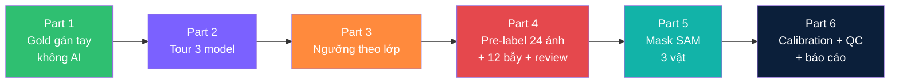

  

# Day 08 Lab — 2A202603225 - Ngô Xuân Tùng

  
  
  
  
  
  

> **Máy gán sẵn, người sửa.** Nhanh hơn vẽ tay — nhưng **bạn** vẫn là chốt chặn chất lượng, và bạn phải **đo** được điều đó.

## Bạn sẽ làm gì

Trong **4 giờ trên lớp** (cài đặt làm trước ~45 phút): chạy ba công cụ pre-label **từ đơn giản đến phức tạp** (YOLO26 → SAM → YOLOE), đưa kết quả vào **CVAT**, **review có quy trình** (có ảnh bẫy để đo chính bạn), rồi **calibration** lại nhãn và guideline.

| Việc | Công cụ |
|---|---|
| Detector danh mục cố định | **YOLO26** |
| Click ra mask (**SAM bắt buộc**, chọn SAM 1 · 2.1 · 3) | **SAM** |
| Gõ chữ ra box + mask (open-vocabulary) | **YOLOE** (nâng cao: Grounding DINO, OWLv2, SAM 3) |
| Đưa nhãn vào CVAT & review | CVAT: import · AI Tools · `cvat-cli` |
| Đo & calibration | `review_stats` · `threshold_sweep` · QC · Release / Hold / Rework |

## Lộ trình

## Bộ dữ liệu: phố châu Á, và những chiếc xe mà COCO không biết tên

36 ảnh (Việt Nam, Thái Lan; CC BY / CC BY-SA / CC0): **gold 4** (gán tay) · **batch 24** (lô thật) · **8 ảnh còn lại** để thử model và cho bài nâng cao. Khoảng 28% ảnh có **tuk-tuk, xích lô, ba gác** (lớp `three_wheeler`): model COCO gọi chúng là `car` / `truck`.

*Cùng một ảnh: (1) YOLO26 gọi tuk-tuk là car/truck · (2) YOLOE gõ chữ tìm đúng nhưng box lỏng · (3) Grounding DINO · (4) box → SAM → mask.*

## Bắt đầu nhanh (5 bước)

1. **Fork** repo thành repo **public** của bạn (tên: xem [SUBMISSION.md](SUBMISSION.md)), `git clone`.
2. **Trước buổi học** (~45 phút): cài môi trường [docs/SETUP.md](docs/SETUP.md) → `python scripts/check_env.py` ra **SẴN SÀNG**. *Máy yếu? Dùng* **[Google Colab](docs/COLAB.md)**.
3. Cài **CVAT bằng Docker** rồi tạo Project từ `cvat/labels_generated.json`: [docs/CVAT_AI.md](docs/CVAT_AI.md) (có hình minh hoạ từng bước).
4. Trên lớp làm theo **[GUIDE.md](GUIDE.md)** từ **Part 1** (gán tay 4 ảnh gold, *chưa* chạy model nào lên ảnh gold!).
5. Chạy `python scripts/check_submission.py` trước khi nộp.

> **Khi nộp:** đổi dòng tiêu đề này thành `# Day 08 Lab — <MSHV> - <Họ và tên>`. Xem [SUBMISSION.md](SUBMISSION.md).

## CVAT: hai cách dùng AI

<table>
<tr>
<td width="50%"> Bố cục màn hình review (sơ đồ minh hoạ)</td>
<td width="50%"> SAM Interactor: click dương / âm → mask (ảnh từ tài liệu CVAT, MIT)</td>
</tr>
</table>

## Quy trình review: 4 bước + quét ảnh trước

<b>Vì sao có "ảnh bẫy" và "gold gán tay"?</b>

Nhãn máy càng trông hợp lý, mắt bạn càng ít nhìn lại ảnh (**thiên kiến tự động hóa**). Bạn sẽ tự đo mình:
- **Gold** (4 ảnh bạn gán tay từ đầu) cho biết máy đúng / sót bao nhiêu **thật sự**.
- **12 ảnh bẫy** (lỗi đã biết, trộn kín trong pre-label) cho biết bạn **bắt được bao nhiêu** lỗi của máy.
- *Accepted cao* mà *bắt bẫy thấp* nghĩa là bạn đang bấm Accept chứ chưa kiểm.

<b>Mình dùng máy yếu / Windows / Mac thì sao?</b>

- **Không GPU / RAM ≤ 8 GB:** chạy model trên **[Colab](docs/COLAB.md)** (GPU T4 miễn phí) hoặc dùng `--size n --imgsz 640` + `mobile_sam.pt` (xem [SETUP.md](docs/SETUP.md) mục 5).
- **Windows:** dùng Git Bash / WSL để chạy y nguyên lệnh, hoặc xem mục "Máy yếu, Windows, Mac" trong [GUIDE.md](GUIDE.md) về PowerShell.
- **Mac Apple Silicon:** chạy tốt trên MPS; lỗi MPS thì `--device cpu` hoặc `PYTORCH_ENABLE_MPS_FALLBACK=1`.

<b>SAM là bắt buộc — chọn phiên bản nào?</b>

| Phiên bản | Chạy bằng | Hợp khi |
|---|---|---|
| SAM 1 (`mobile_sam.pt`, `sam_b.pt`) | `--sam mobile_sam.pt` | máy yếu |
| **SAM 2.1** (`sam2.1_b.pt`) — khuyến nghị | `--sam sam2.1_b.pt` | cân bằng chất lượng / tốc độ |
| SAM 3 (gated, gõ chữ ra mask) | `--model sam3` | có GPU + quyền truy cập |

Chi tiết và cách ghi vào `REPORT.md` mục 1: [docs/MODELS.md](docs/MODELS.md) mục B0.

## Tài liệu

| Bạn cần | Xem |
|---|---|
| Các Part và lệnh chạy | [GUIDE.md](GUIDE.md) |
| Mốc tiến độ | [CHECKPOINTS.md](CHECKPOINTS.md) |
| Quy tắc làm bài | [RULES.md](RULES.md) |
| Chấm điểm (100 điểm) | [RUBRIC.md](RUBRIC.md) |
| Sản phẩm phải nộp, tên repo | [SUBMISSION.md](SUBMISSION.md) |
| Cài đặt môi trường, tải model | [docs/SETUP.md](docs/SETUP.md) |
| Chạy trên Google Colab | [docs/COLAB.md](docs/COLAB.md) |
| Tour 3 model: YOLO26, SAM, YOLOE | [docs/MODELS.md](docs/MODELS.md) |
| Bài nâng cao (tuỳ chọn): Grounding DINO, OWLv2, SAM 3, `cvat-cli`, pilot, mask 8 ảnh | [docs/ADVANCED.md](docs/ADVANCED.md) |
| CVAT: import, AI Tools, `cvat-cli` (có hình) | [docs/CVAT_AI.md](docs/CVAT_AI.md) |
| Quy trình review, ảnh bẫy | [docs/REVIEW_CHECKLIST.md](docs/REVIEW_CHECKLIST.md) |
| Chọn ngưỡng theo lớp (Part 3) | [docs/THRESHOLD.md](docs/THRESHOLD.md) |
| Calibration & QC (Part 6) | [docs/CALIBRATION_QC.md](docs/CALIBRATION_QC.md) |
| Label contract (guideline v1.0) + khung v1.1 | [guideline/](guideline/) |
| Các script | [scripts/README.md](scripts/README.md) |
| Nguồn & giấy phép ảnh | [data/README.md](data/README.md), [data/ATTRIBUTION.csv](data/ATTRIBUTION.csv) |
| Thông tin & kết quả tóm tắt của bạn | [STUDENT.md](STUDENT.md) |

## Bạn học được gì

- Chọn đúng **họ model** cho việc: click (SAM) · gõ chữ (YOLOE, Grounding DINO, OWLv2, SAM 3) · danh mục cố định (YOLO26).
- Đưa nhãn máy vào CVAT bằng **offline import**; (nâng cao) dùng AI **trực tiếp** trong CVAT (AI Tools, `cvat-cli`).
- Duyệt bằng **checklist bốn bước**; nhận ra **thiên kiến tự động hóa** bằng **ảnh bẫy** của chính bạn.
- Đo **AI error profile** (accepted / edited / deleted / added), precision / recall của máy so với **gold gán tay**.
- **Calibration**: ngưỡng theo lớp · guideline v1.1 · QC với Release / Hold / Rework (nâng cao: đo nhất quán của chính bạn).

Ảnh minh hoạ giao diện CVAT trong `docs/assets/cvat/` lấy từ tài liệu CVAT (MIT). Sơ đồ khác do giảng viên vẽ (`docs/assets/make_figures.py`).
